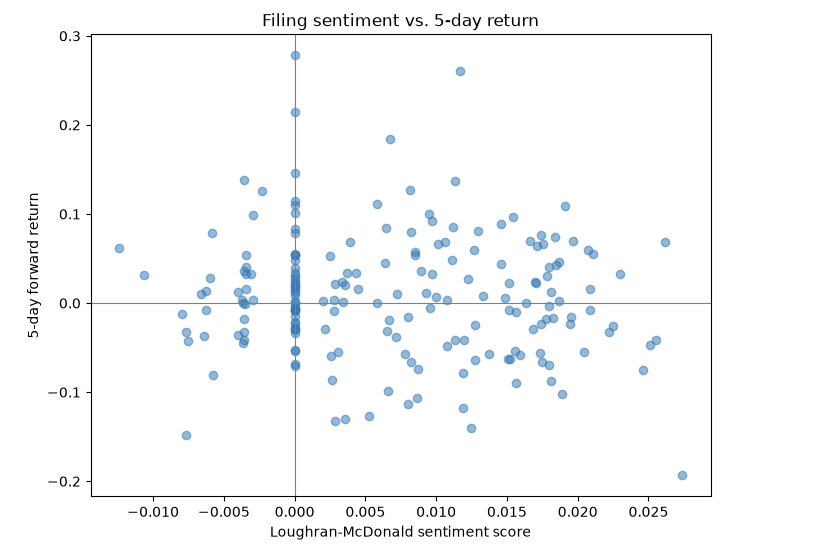

# SEC Filing Sentiment vs. Stock Returns

Does the sentiment of a company's earnings press release predict how its stock moves afterward? This project builds a pipeline that downloads earnings releases from SEC EDGAR, scores their sentiment two ways, and tests those scores against the stock's return over the following 1, 5, and 20 trading days.

By Prudhvi.

## Finding

Across 192 earnings releases from 9 large companies (2015–2026), sentiment scores have close to no relationship with subsequent returns.

| Sentiment score | vs 1-day return | vs 5-day return | vs 20-day return |
|---|---|---|---|
| VADER (general-purpose) | -0.08 | -0.17 | -0.06 |
| Loughran-McDonald (finance) | -0.11 | -0.10 | -0.04 |

Every correlation sits near zero. The scatter below shows it directly: filings with high sentiment (right side) have the same spread of returns as filings with low sentiment (left side). No upward tilt.



This is the result you'd expect if markets work. The stock reacts to the numbers in the release (did earnings beat expectations?), not to the adjectives around them. Companies also write every release in upbeat language regardless of the quarter, so the sentiment carries little new information. A reliable word-counting edge would have been arbitraged away long ago.

The small negative sign is too weak to lean on, but it's consistent with a "buy the rumor, sell the news" pattern, where the most enthusiastic releases are sometimes followed by a pullback.

## A second finding: the two lexicons disagree in shape

VADER rates almost every earnings release as strongly positive. Its score distribution has a skew of -2.07, meaning the mass piles up near the top with a thin tail of less-positive filings. The Loughran-McDonald finance lexicon, built specifically for financial text, produces a balanced distribution (skew 0.2) with genuinely negative, neutral, and positive filings.

So the finance lexicon tells earnings releases apart where VADER rates them all the same. But neither one predicts returns, so that extra resolution doesn't translate into signal here.

## Pipeline

Four stages, one notebook each:

1. **Ingest** (`01_ingest.ipynb`) — Maps tickers to SEC CIK IDs, pulls each company's filing history, filters to earnings 8-Ks (item 2.02), and downloads the earnings press release from each filing. Finds the press release by its SEC exhibit type (EX-99.1) rather than by file name, since companies name their files inconsistently. Downloads are incremental (skips files already saved) and respect the SEC's 10-request-per-second limit.

2. **Clean** (`02_clean.ipynb`) — Strips HTML with BeautifulSoup, removes financial tables (which are numbers, not sentiment), and trims the legal boilerplate. Filings over 8,000 characters are flagged as cleaning failures and excluded, which cut the usable set from 339 to 192.

3. **Score** (`03_sentiment.ipynb`) — Scores each filing with VADER and with a self-implemented Loughran-McDonald count (net positive words over total words).

4. **Returns** (`04_returns.ipynb`) — Pulls daily prices with yfinance, aligns each filing to the trading calendar, computes forward returns at 1/5/20 trading days, and correlates them with the sentiment scores.

## Data sources

- SEC EDGAR submissions and filing archives (free, public)
- Loughran-McDonald Master Dictionary, University of Notre Dame
- Daily prices via yfinance

## Running it

```
conda create -n filing-sentiment python=3.11
conda activate filing-sentiment
pip install -r requirements.txt
```

Then run the notebooks in order, 01 through 04. The raw filings and the L-M dictionary aren't committed (see `.gitignore`); `01_ingest.ipynb` redownloads the filings, and the dictionary is a free download from the Notre Dame link above. The processed CSVs in `data/processed/` are included, so the later notebooks run without redownloading.

## Companies

Coverage is good for AAPL, COST, TSLA, CF, MSFT, and GOOGL. AMZN, T (AT&T), and UNH have few usable filings because their layouts defeated the cleaning step more often.

## Known limitations

- **Cleaning quality varies by company.** 147 of 339 filings were dropped for failing the length check. The filing layouts differ enough that one cleaning rule doesn't fit all of them.
- **VADER is out of domain.** It was built for social media, so it misreads financial vocabulary. That's the reason the Loughran-McDonald lexicon is included as a comparison.
- **Lexicon scoring is shallow.** Both methods count words and ignore context, negation, and magnitude. A transformer model trained on financial text (e.g. FinBERT) would be the natural next step.
- **Small sample.** 192 filings across 9 companies is enough to see the null result, not enough to make strong claims about subgroups.

## Possible next steps

- Test fundamentals instead of words: does EPS surprise (reported vs. expected) predict returns where sentiment doesn't?
- Improve extraction to recover the dropped filings and widen the sample.
- Add FinBERT as a third scoring method.
